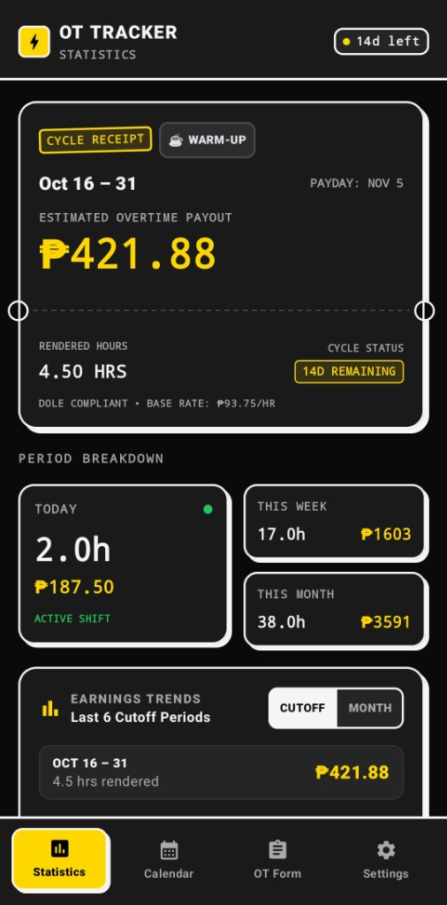
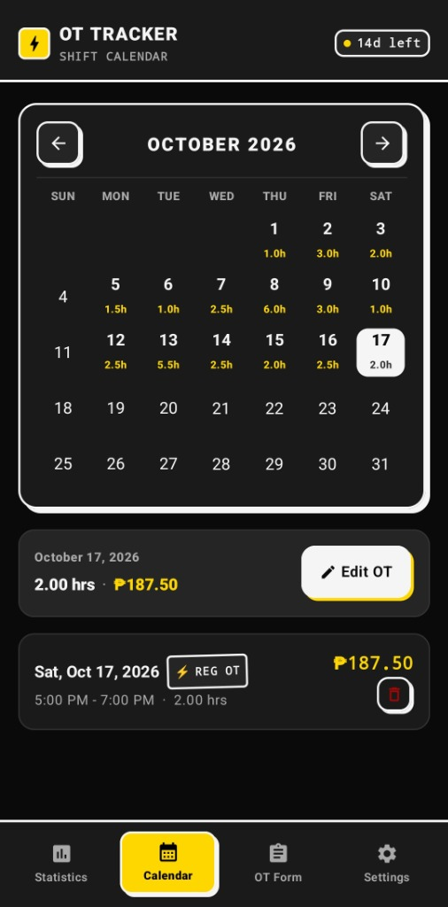
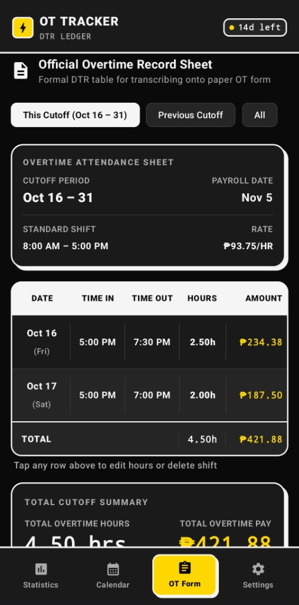
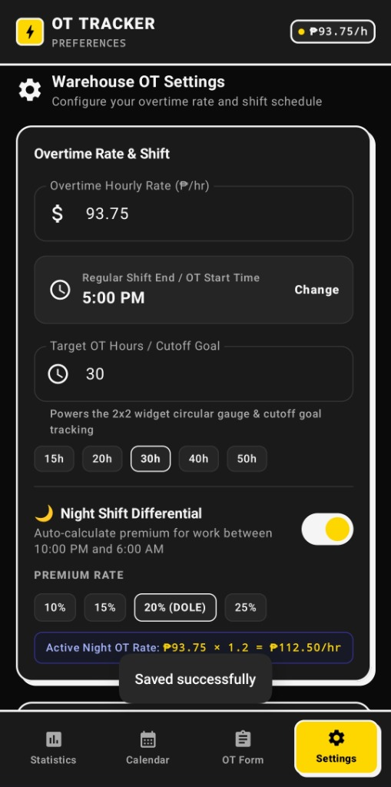

# Overtime Tracker

**A simple, offline Android app to track your overtime hours and compute your cutoff pay based on Philippine labor rules.**

 

[**Download Overtime Tracker (v1.5.1 APK)**](https://github.com/KouseiA/Overtime-Tracker/releases/download/v1.5.1/OvertimeTracker-v1.5.1.apk) • [**View Changes**](CHANGELOG.md)

---

## Screenshots

| Dashboard | Shift Calendar | DTR Sheet | Settings |
|:---:|:---:|:---:|:---:|
|  |  |  |  |
| *Total pay & hours* | *Tap days to log OT* | *Ready for paper forms* | *Set your hourly rate* |

---

## What Does This App Do?

Writing down overtime on scratch paper or trying to do the math in your head often leads to mistakes. **Overtime Tracker** makes it simple:

- **100% Offline & Private**: No sign-up, no login, and no internet needed. All your hours stay saved only on your phone.
- **Accurate DOLE Rates**: Automatically computes regular overtime, holiday pay, and night differential.
- **Keep Your Own Records**: Keep a personal log of your overtime hours and estimated pay so you have a copy to reference when your payslip arrives.

---

## Overtime Rates (DOLE Rules)

The app automatically computes your pay using standard Philippine labor rules:

| Day Type | Rate | With Night Differential (10 PM – 6 AM) |
|---|:---:|:---:|
| **Regular Workday** | **125%** (`× 1.25`) | **150%** (`× 1.50`) |
| **Rest Day** | **169%** (`× 1.69`) | **202.8%** (`× 2.028`) |
| **Special Non-Working Holiday** | **130%** (`× 1.30`) | **156%** (`× 1.56`) |
| **Regular Holiday** | **200%** (Double Pay) | **240%** (`× 2.40`) |
| **Night Shift Differential** | **+20%** standard | Automatically applied between 10:00 PM and 6:00 AM |

---

## Main Features

### 1. Payday & Cutoff Tracker
- Works with common Philippine cutoff schedules:
  - **1st to 15th** (Payday on the 20th) & **16th to end of month** (Payday on the 5th)
  - **11th to 25th** & **26th to 10th**
  - Or choose your own custom cutoff dates.
- Shows a countdown of how many days are left in your cutoff.

### 2. Paper-Ready DTR Table
- Formatted just like a company overtime slip (`Date`, `Time In`, `Time Out`, `Hours`, `Amount`).
- Easy to copy onto your paper form before passing it to HR or your supervisor.
- Filter by **Current Cutoff**, **Previous Cutoff**, or **All Records**.

### 3. Automatic Night Differential
- If your overtime extends past 10:00 PM, the app automatically splits your hours into Day OT and Night OT.
- No need to do the math yourself.

### 4. Home Screen Widgets
Check your hours and earnings right on your home screen without opening the app:
- **Glance Cutoff Card (4×2)**: Declarative Jetpack Glance widget showing your live cutoff dates, earnings in bold gold, hours rendered, and a 1-tap `+ LOG OT` action button.
- **Compact Circular Gauge (2×2)**: Tactile gauge displaying your cutoff progress and earnings at a glance.

### 5. Backup & Transfer
- Save your shift records to a backup file anytime.
- Easily restore your data if you buy a new phone.

---

## How to Install

1. Download the APK file: [**Download OvertimeTracker-v1.5.1.apk**](https://github.com/KouseiA/Overtime-Tracker/releases/download/v1.5.1/OvertimeTracker-v1.5.1.apk)
2. Tap the downloaded file on your Android phone.
3. If asked, tap **Allow install from unknown sources**.
4. Open the app and set your hourly rate!

---

## Note

> **Paalala:** The numbers in this app are estimates to help you track your own hours. Your official company payslip may differ slightly due to tax deductions, SSS/PhilHealth/Pag-IBIG, or company-specific policies.

---

## License

Free and open-source under the [MIT License](LICENSE).
